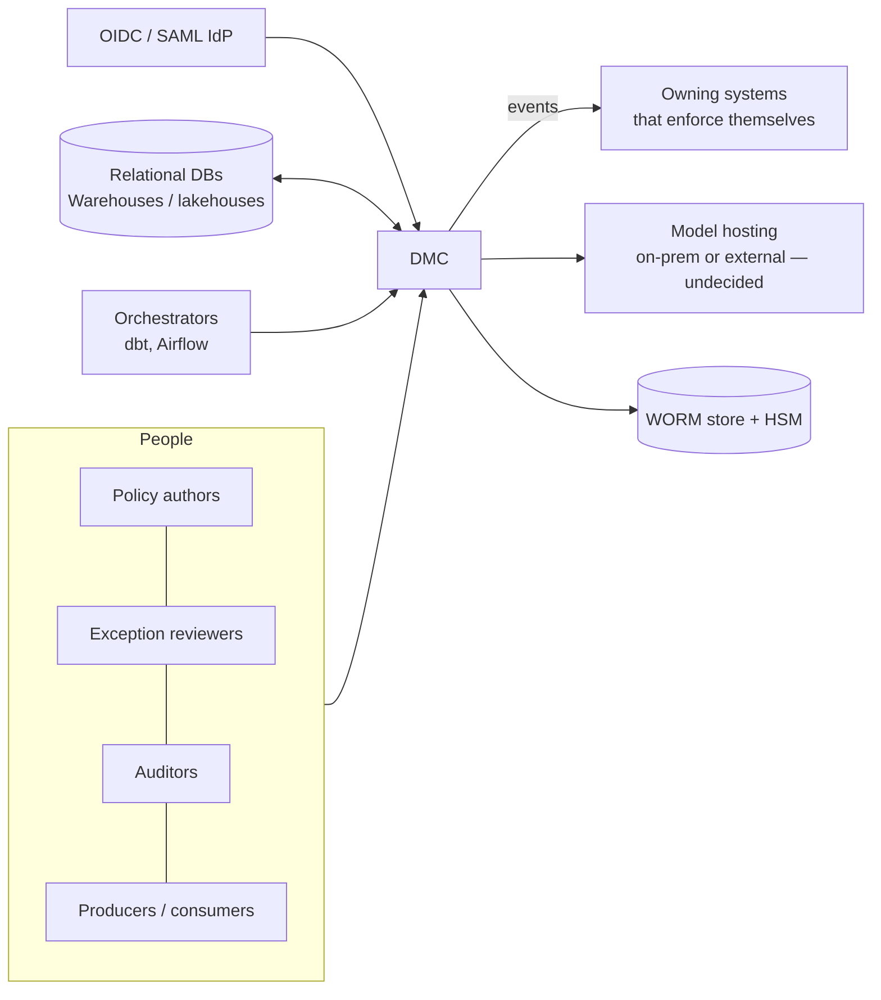
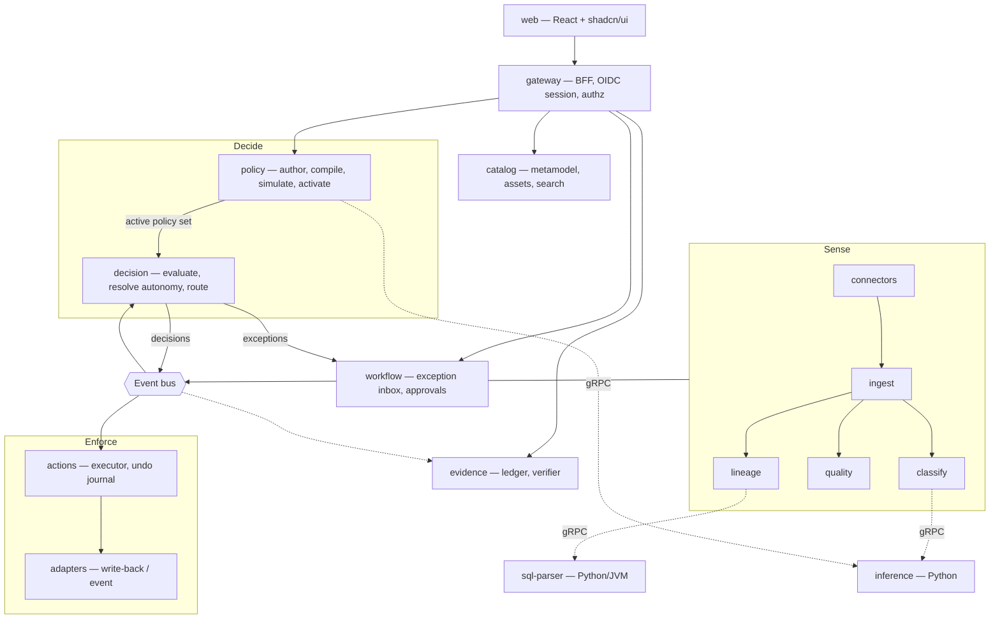

# DMC System Design

Companion to *DMC Blueprint v4: Low-Touch Data Governance* and the metamodel draft. The blueprint says **what** DMC is; this says **how it is built**. Items marked **[Proposed]** are my recommendations where the blueprint left a gap; **[Assumed]** are sizing guesses to confirm.

## 1. Design drivers

| Driver | Consequence for the design |
|---|---|
| Low human touch | Everything is an event-driven loop; humans enter only through exception queues and policy authoring |
| Policy is the product | One policy runtime shared by simulation, dry-run and live evaluation, so they cannot diverge |
| Provable | Every state change is written to the ledger in the same transaction as the change (outbox) |
| Millions of assets, column-level lineage | Graph tier behind a port; bounded, incremental propagation; no full-graph recomputes |
| Internal, single tenant, on-prem K8s | No tenant isolation layer; no managed cloud services; every dependency must run in-cluster |
| TypeScript-first | Python/JVM only for SQL lineage parsing and ML/LLM inference, behind gRPC |
| Reversibility per control type | Every action has an undo contract declared by its control type |

**Scale targets [Assumed]:** ≤10M assets, ≤1B column nodes, ~3B lineage edges; 5k signals/s peak; 2k ledger entries/s peak; ≤200 concurrent UI users; decision latency (signal → action dispatched) p95 < 30 s for automated paths.

## 2. System context



## 3. Logical architecture

One deployable per bounded context, one package per context in the monorepo, boundaries enforced in CI (import rules) and at the database (one schema and one DB role per context; no cross-schema grants).



| Context | Owns | Key responsibilities |
|---|---|---|
| **catalog** | Metamodel registry, asset nodes/edges (Postgres), search index | Type registry with dry-run change impact; asset lifecycle (discovered → proposed → confirmed → deprecated); serves UI reads |
| **connectors / ingest** | Source credentials refs, scan state | Scheduled + CDC/metadata scans, query-log pull; normalize to `Signal`; backpressure per source |
| **classify / quality** | Detector configs, run results | Rules + ML classifiers emit classification and quality signals with confidence |
| **lineage** | Lineage store (graph), propagation jobs | Merge parsed/orchestrator/declared edges; confidence scoring; incremental propagation |
| **policy** | Policy source (Git-backed), compiled IR, activation state | NL → DSL, validation, conflict detection, simulation, staged rollout |
| **decision** | Decision log (pre-ledger), active-policy cache | Evaluate signals against policies; resolve autonomy; pick exception route |
| **actions / adapters** | Action queue, undo journal | Execute decisions via write-back or event emission; idempotency; rate limits; kill switch |
| **workflow** | Exception items, approvals | Inbox for reviewers, SLA timers, escalation as policy declares |
| **evidence** | Ledger tables, checkpoints | Append, batch, sign, anchor, verify |
| **gateway** | Sessions, BFF aggregation | OIDC/SAML login, role checks for DMC's own users, request fan-out |

Python/JVM services (`sql-parser`, `inference`) are stateless, versioned independently, and called only through narrow gRPC contracts owned by the calling context.

## 4. Core flows

**4.1 The loop (Sense → Decide → Enforce → Evidence)**
1. A connector emits a `Signal` (e.g. "column X looks like national ID, p=0.93"). Ingest writes it and the outbox row in one transaction.
2. `decision` consumes it, resolves **governing policies** for the asset (scope match through domain, classification, system), and evaluates.
3. Autonomy is resolved: `effective = min(policy.ceiling, tier(confidence, policy.thresholds))`. Outcomes: *act*, *act + notify*, *propose* (to exception route), or *drop*.
4. *Act* → `actions` executes via an adapter; *propose* → `workflow` creates an exception item addressed per the policy's routing rule.
5. Each step (signal, policy version used, decision with inputs and confidence, action result, human approval) is written to the ledger.

**4.2 Policy activation**
Draft (NL) → compile to DSL → validate against metamodel → static conflict check → **dry-run** over the real estate (read-only, same evaluator) → report (assets affected, actions that would fire, projected exceptions) → staged rollout to an asset subset with auto-halt thresholds → full activation. A conflict blocks the transition to staged rollout. Activation is itself a ledger event.

**4.3 Lineage propagation**
New/changed edge → impact traversal (downstream by default, depth- and fan-out-bounded) → for each reached node, attribute carried by the edge type is propagated if edge confidence ≥ threshold, else a *propose* decision goes to the exception route. Propagation runs as a Temporal workflow per root change, chunked and resumable.

**4.4 Exceptions**
Policy declares route (domain owner, steward group, central team, or a rule). Item carries the decision context and a recommended action; reviewer approve/reject/modify is a ledger event. Unanswered items follow the policy's escalation timer. Reviewer outcomes feed back as labeled data for detector tuning **[Proposed]**.

## 5. Data architecture

| Store | Holds | Why |
|---|---|---|
| Postgres (HA, per-context schemas) | Metamodel registry, assets/edges (system of record), policies, decisions, exceptions, ledger | One transactional core; bitemporal columns (`valid_from/to`, `recorded_at`) on nodes and edges |
| Graph tier (JanusGraph on ScyllaDB) | Column-level lineage for traversal | Billions of nodes, multi-hop traversal; **behind a `LineageStore` port** so Postgres closure tables can replace it |
| OpenSearch | Catalog search, facets | Full-text over millions of assets |
| Kafka-compatible bus | Signals, decisions, actions, lineage changes | Replay, backpressure, per-key ordering |
| Object storage (MinIO) | Scan artifacts, ledger checkpoints (WORM bucket, object lock) | Cheap bulk; immutability |
| Vault / HSM | Ledger signing key, connector credentials | Keys never in app config |

**Consistency rules**
- **Transactional outbox** in every context that publishes events; a relay publishes to the bus. No dual writes.
- Consumers are idempotent (event id dedupe table). At-least-once everywhere.
- Postgres → graph and Postgres → search are derived projections, rebuildable from the system of record.
- Partition key for signals and decisions is `asset_id`, so evaluation for one asset is ordered.

**Core topics:** `signals.v1`, `decisions.v1`, `actions.v1`, `lineage.changes.v1`, `policy.activated.v1`, `exceptions.v1`. Schemas in a registry (JSON Schema or Avro), versioned, backward-compatible only.

**Ledger entry (minimum):** `seq`, `kind` (signal / policy_version / decision / action / approval / metamodel_change), `subject_ref`, `payload_hash`, `payload` (or pointer), `actor` (system component, model+version, or user), `recorded_at`, `prev_batch_root`.

## 6. Policy runtime  **[Proposed]**

- **Source of truth:** DSL in Git-backed storage (reviewable, diffable). NL is an authoring aid; the LLM output is never executed until it compiles, validates and the author accepts the DSL.
- **IR:** DSL compiles to a typed IR (scope, condition, effect, autonomy ceiling, thresholds, reversibility, routing). One TS evaluator runs the IR for live, simulation and dry-run.
- **Engine choice:** Cedar and OPA are built for allow/deny authorization; DMC policies are condition → effect rules with confidence semantics. Recommendation: own small evaluator over the IR, spike Cedar for the scope/applicability layer only. Decide in an ADR after a one-week spike.
- **Conflict detection:** two rules conflict when their scopes can overlap and their effects are incompatible (e.g. retain 7y vs delete at 90d on the same classification). Scope overlap is checked against the metamodel (type/concept hierarchy) plus a sampled estate check to avoid false positives from impossible combinations.
- **Scale:** active policies are indexed by scope key (type, concept, domain) so evaluating a signal touches tens of rules, not thousands.

## 7. Enforcement  **[Proposed]**

Adapter contract, per target system:

```
capabilities(): { actions: ActionType[], modes: ('write-back'|'event')[] }
dryRun(action): Impact
apply(action, idempotencyKey): Result
undo(action, result): Result | NotReversible
```

- **Reversibility** is declared by the control type's policy: `reversible` (undo journal retains prior state), `grace` (soft-delete / quarantine window, then purge as a separate, separately-approved action), or `irreversible` (policy must route to a named approver; autonomy ceiling cannot exceed *propose* unless the policy explicitly allows it).
- **Safety rails (all adapters):** per-target rate limits, blast-radius cap per policy per hour (exceeding it pauses the policy and raises an exception), and a global and per-policy **kill switch** that stops dispatch without losing queued decisions.
- **Event mode:** emit a signed action request to the owning system and track acknowledgement; unacknowledged actions escalate and are visible as "pending enforcement" in the catalog.

## 8. Evidence ledger

As in the blueprint, with the operational detail:

- **Write path:** an `evidence` consumer reads the bus plus direct outbox entries, assigns `seq` from a single-writer sequence per shard, appends to a time-partitioned table (UPDATE/DELETE revoked from every role; only the `evidence_writer` role may INSERT).
- **Batching:** every N seconds or M entries, build a Merkle tree, compute `root = H(prev_root ‖ merkle_root ‖ seq_range)`, sign with the HSM key, write checkpoint to the WORM bucket. Starting point: 5 s / 5,000 entries **[Assumed]**.
- **Ordering:** one logical chain; shard by hash only if sustained throughput exceeds a single writer, then chain shard roots into a parent root.
- **Verifier:** independent service and CLI. Replays hashes from the table, compares roots with WORM checkpoints, reports the first divergence. Runs continuously on recent partitions and nightly in full; a failure pages and freezes autonomous actions.
- **Payloads:** large payloads (model inputs) stored in object storage; the ledger holds the hash and pointer.
- **Retention of evidence itself** follows its own retention policy; checkpoints are never deleted, so pruned payloads remain provable by hash.

## 9. AI layer

- `inference` service exposes typed operations (`classify`, `compileMetamodelQuery`, `nlToDsl`, `explainDecision`), not a raw prompt API. Callers never see which backend serves them.
- Backend is swappable per operation: on-prem GPU, external API, or split by data sensitivity (decision pending). **Default until decided [Proposed]:** anything that touches sample data values stays on-prem; external models may see only metadata and synthetic examples.
- Every model call records model id, version, prompt template hash, input hash and output in the ledger.
- Guardrails **[Proposed, to confirm]:** structured outputs validated against schemas; models can propose and score but cannot execute: only policy-evaluated decisions reach `actions`; prompt-injection hardening on any ingested text (column comments, descriptions) by treating it as data fields, never as instructions; confidence calibration measured against reviewer outcomes, with auto-downgrade of a detector whose calibration drifts.

## 10. Security

- **Users:** existing OIDC/SAML IdP; DMC roles (policy author, reviewer, auditor, admin, viewer) mapped from IdP groups; enforced in the gateway and re-checked in each service (JWT propagated, not trusted blindly).
- **Services:** mTLS between services (mesh or cert-manager), NetworkPolicies default-deny, one K8s service account and one DB role per context.
- **Secrets:** Vault; connector credentials are references resolved at call time with short-lived leases; scoped read-only for Sense, separate write credentials for Enforce.
- **Data minimization:** Sense stores metadata, statistics and bounded samples; samples are classified, encrypted, TTL'd, and never leave the cluster by default.
- **Data access control** is out of launch scope; DMC does not broker access to the underlying data.
- **Audit of DMC itself:** admin and policy actions flow through the same ledger.

## 11. Deployment and operations

- **Kubernetes:** one Deployment per context; HPA on queue lag for consumers (ingest, classify, decision, actions); Temporal cluster in-cluster with its own Postgres; Strimzi Kafka (3+ brokers); ScyllaDB (3+ nodes, rack-aware); Postgres via an operator (CloudNativePG) with streaming replicas and PITR.
- **Isolation of load:** connectors and scans run in a separate node pool with quotas so a scan storm cannot starve decision/action services.
- **Observability:** OpenTelemetry traces across bus hops (trace id in event headers), Prometheus metrics, structured logs. Product SLIs: signal-to-decision lag, decision-to-action lag, exception queue age, ledger lag (entry → anchored), verifier status, lineage freshness per source.
- **SLOs [Assumed]:** decision path p95 < 30 s; ledger anchor lag < 60 s; UI reads p95 < 400 ms; ledger and catalog RPO ≤ 1 min, RTO ≤ 1 h.
- **DR:** Postgres PITR + cross-site replica; WORM bucket replicated; graph and search are rebuilt from Postgres, so they are excluded from RPO.
- **Delivery:** monorepo, per-package build and test, container per context, Helm/Argo CD; metamodel and policy changes follow their own promotion path, not the app release train.
- **Upgrades:** event schemas and gRPC contracts are backward-compatible for one release; DB migrations are expand/contract.

## 12. Repository layout

```
/packages
  web/            React app + design system (DESIGN.md)
  gateway/
  catalog/  connectors/  ingest/  classify/  quality/  lineage/
  policy/   decision/    actions/  adapters/ workflow/ evidence/
  contracts/      event schemas, gRPC protos, shared types (the only cross-package import)
/services-py
  sql-parser/  inference/
/deploy           Helm charts, Argo apps, operators config
/docs             blueprint, metamodel, this document, ADRs
```

CI rules: no import between context packages except via `contracts`; each context's DB role can only touch its own schema; a package's public surface is its API/event contract.

## 13. Decisions to record (ADRs)

| # | Decision | Status |
|---|---|---|
| 1 | Policy runtime: custom IR evaluator vs Cedar vs OPA | Spike, then decide |
| 2 | Graph tier: JanusGraph/Scylla vs Postgres closure tables, behind `LineageStore` | Start with port + Postgres implementation; add graph at the measured threshold |
| 3 | Bus: Strimzi Kafka vs Redpanda | Open (ops familiarity) |
| 4 | Ledger sharding | Single chain until measured otherwise |
| 5 | Model hosting and data-sensitivity split | Open (blueprint) |
| 6 | Metamodel: single inheritance, who edits the registry, policy reference by type vs capability | Open (metamodel doc) |
| 7 | Write-back connectors vs event enforcement per source | Open (blueprint) |

## 14. Open questions this design exposes

1. **Graph on day one?** Starting on Postgres behind the port could save a lot of operational weight; the cutover trigger would be a measured traversal latency, not a guess. Worth confirming you're happy with that sequencing risk.
2. **Learning loop:** should reviewer outcomes automatically tune detector thresholds, or only produce reports? (Automatic tuning is itself a governed change.)
3. **Trust score:** it will be a derived read-model over quality, lineage health and policy compliance; its definition is still deferred.
4. **Regulations in scope** will shape ledger retention and privacy/consent control payloads.
